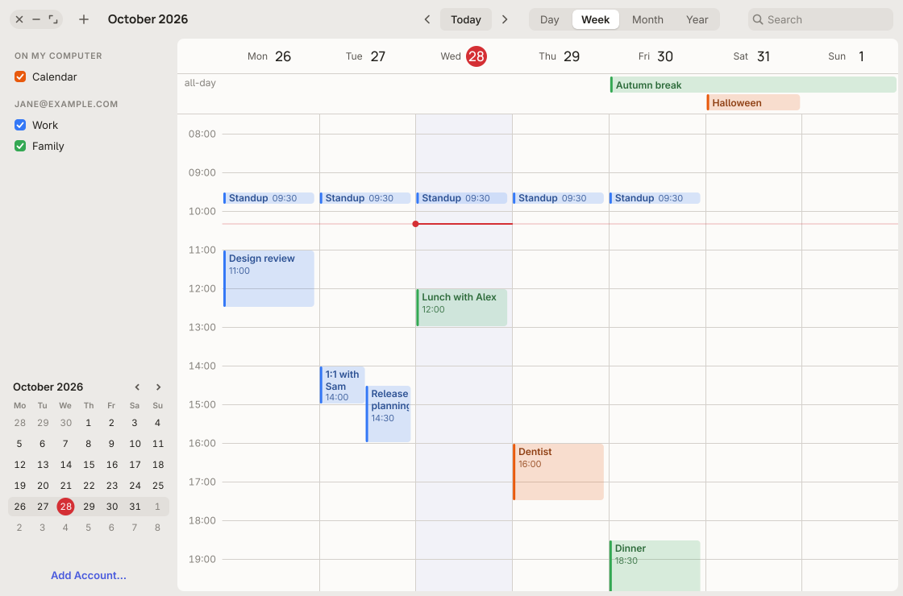

# Bande Calendar

A calendar for the Bande desktop, modelled on macOS Calendar: CalDAV accounts that work offline,
a local "On My Computer" calendar, and read-only subscriptions, shown in day, week, month and year
views. Packaged as `bande-calendar`.



## What it does

- **Accounts.** CalDAV (RFC 4791) with discovery: a full URL, a host name or just an e-mail
  address. It tries `_caldavs._tcp` / `_caldav._tcp` DNS SRV records, `/.well-known/caldav`, then
  `current-user-principal` → `calendar-home-set` → the calendars in the home set. Passwords go to
  the Secret Service (gnome-keyring), never to disk. Several accounts, plus a local calendar.
- **Subscriptions.** `webcal:` / `webcals:` links and plain `https:` `.ics` URLs, read-only,
  refreshed hourly; the name and colour come from `X-WR-CALNAME` and `X-APPLE-CALENDAR-COLOR`.
- **Offline sync.** Every calendar is cached on disk with its pending changes, so it works
  without a network and pushes changes later. Sync is incremental with `sync-token`
  (RFC 6578), falling back to ctag + etag listings on servers without it. Creates use
  `If-None-Match: *`, edits and deletes `If-Match`; a 412 keeps the server's copy and says so
  in the sidebar.
- **iCalendar.** Its own parser and writer: line folding, escaping, unknown properties and
  components kept on round trip, `RRULE` (every frequency and `BY*` part, `COUNT`, `UNTIL`,
  `BYSETPOS`, week numbers), `EXDATE`, `RDATE`, `RECURRENCE-ID` overrides, all-day events,
  `VALARM`, and time zones: `TZID`s resolve through the system tz database (also Outlook's
  Windows names and prefixed Mozilla names), unknown ones through their `VTIMEZONE` (converted to
  a POSIX rule). Written events carry a `VTIMEZONE` generated from the tz database.
- **Views.** Day, week, month and year, a mini month and the calendar list in the sidebar,
  per-calendar colours and visibility, Today and previous/next.
- **Calendars.** New, rename and delete, on this computer or on a CalDAV server (MKCALENDAR,
  PROPPATCH of the name and colour, DELETE): File ▸ New Calendar…, or right-click a calendar or
  an account heading.
- **Editing.** Drag on empty time to create, drag an event to move it (also between days in the
  month view and into the all-day row), drag its bottom edge to change its length, and an
  inspector popover with title, location, all-day, start and end, repeat, alert, calendar and
  notes. Changing a recurring event asks whether it is for this event only (an override) or
  all events.
- **Search** over title, location and notes, nearest occurrence first.
- **Alerts** through `org.freedesktop.Notifications`.
- **Files and links.** `bande-calendar file.ics` offers to add its events; `bande-calendar
  webcal://…` offers to subscribe. The desktop file registers `text/calendar` and the `webcal`
  schemes.

Shortcuts: Super+1…4 for the views, Super+T today, Left/Right previous/next, Super+N new event,
Alt+Super+N new calendar,
Super+F search, Super+R refresh, Delete to delete, Enter to open the selected event.

## Layout

| Path | What it is |
|---|---|
| `src/ical/` | iCalendar: content lines, values and durations, time zones, recurrence, events |
| `src/caldav/` | HTTP, WebDAV XML, DNS SRV, discovery and the CalDAV requests |
| `src/store.rs` | accounts, calendars and the offline cache in `~/.local/share/bande-calendar` |
| `src/sync.rs` | push pending changes, pull with sync-token or ctag/etag, apply the outcome |
| `src/edit.rs` | the edits the UI makes: create, move a series or one occurrence, delete, details |
| `src/alerts.rs` | which alarms fall due |
| `src/secrets.rs` | the Secret Service |
| `src/worker.rs` | the network thread the window talks to |
| `src/ui/` | the window: toolbar, sidebar, the four views, inspector, account sheet, input |
| `src/main.rs` | the app: window, menus, sync timers, alerts, files and links |

It uses the desktop's toolkit, design tokens and theme (light/dark, accent, text size), like
Files and Settings. For now it depends on the desktop crates by path
(`/home/mikael/unbound-linux/repos/desktop`); that becomes a git dependency on
`bande-linux/desktop` once the desktop is published, so this app must not reach `main` before.

## Tests

```
cargo test
```

- `src/**` unit tests: parsing, folding, recurrence edge cases (DST changes, the spring gap,
  leap days, `BYSETPOS`, week numbers), time zones, overrides, edits, alerts.
- `tests/caldav.rs` runs against a real Radicale started by the test (`apt install radicale`; it
  runs `python3 -m radicale`): discovery, two devices syncing creates, edits and deletes, 412
  conflicts, invalid sync tokens, colours, creating, renaming and deleting calendars.
- `tests/legacy.rs` runs against a small in-test server without sync tokens, for the ctag/etag
  path.
- `tests/drag.rs` drives the view with pointer and key events: create, move, resize, month
  drag, calendar colours, and new, rename and delete calendar through the menus and sheets.
- `tests/golden.rs` renders each view with the desktop's golden harness (light and dark, the
  inspector, search). After a deliberate visual change, `UNBOUND_UPDATE_GOLDENS=1 cargo test
  --test golden` rewrites them.

## Not done yet

- Invitations (attendees, `METHOD:REQUEST`/`REPLY`), free/busy, tasks (`VTODO`).
- OAuth providers (Google, Microsoft); Basic authentication only, so iCloud and Fastmail work with
  an app password.
- Editing the time zone of an event; custom repeat rules (they are kept and shown as Custom,
  but not edited).
- One window per launch: opening an `.ics` file while Calendar runs opens a second window.
